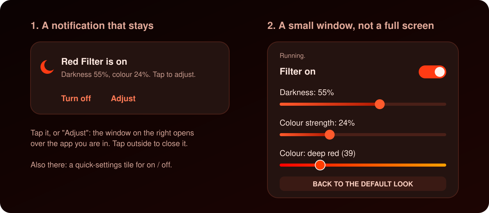

<p align="center"></p>

**Red Filter** puts one dark red colour layer over the whole screen of an Android phone, so a bright page stops
lighting up the room at night. You set how dark and how red. That is all it does.

<p align="center"></p>

## What you get

| | |
|---|---|
| **One layer over everything** | An accessibility overlay: it sits above the app you are in and lets every touch through. |
| **Three sliders** | Darkness, colour strength, colour (pure red to orange). Every change shows at once. |
| **Controls where you are** | A notification with `Turn off` and `Adjust`, a small slider window, and a quick-settings tile. |
| **Nothing else** | No internet permission, no ads, no tracking, no account. The app is about 21 KB. |
| **Cannot black itself out** | The screen always keeps at least 4% of its light, so the controls stay visible. |

<p align="center"></p>

## How the colour is made

Two layers are folded into one colour: a black layer (Darkness) and a colour layer on top of it (Colour strength).
For a screen pixel `P`:

```
shown = P x (1 - strength) x (1 - darkness) + colour x strength
```

With the default look (darkness 55%, strength 24%, colour `255, 39, 0`), white `255, 255, 255` is shown as about
`148, 97, 88` and black as about `60, 9, 0`.

## Install

There is no store listing. Build the APK yourself (it takes a few seconds, no Gradle):

```bash
bash build.sh            # writes RedFilter.apk
bash build.sh install    # also sends it to a phone over USB and switches the filter on
```

Needs a JDK (17 works) and the Android SDK with `build-tools` and one `platforms/android-NN` folder.
Set `ANDROID_SDK_ROOT`, `BUILD_TOOLS`, `PLATFORM`, `JAVA_HOME` or `KEYSTORE` in the environment, or in a file
`local.env` next to `build.sh`, if the defaults at the top of the script do not match your machine.

By hand instead of `build.sh install`: install the APK, then switch the service on in
**Settings > Accessibility > Downloaded apps > Red Filter**.

## Why it asks for accessibility access

Android only lets an accessibility service draw a layer that covers every app and still passes touches through
at any darkness. Red Filter uses the service for that one layer. It asks for no screen content
(`canRetrieveWindowContent="false"`), handles no events, and has no internet permission, so nothing can leave the phone.

## If the phone switches the filter off

Some phones stop background apps and leave the service marked "on" but not running. Open the app once: with the
permission below it reconnects itself; without it, switch the service off and on in the accessibility settings.

```bash
adb shell pm grant io.github.nostramadeus.redfilter android.permission.WRITE_SECURE_SETTINGS
```

(`build.sh install` tries this for you. Some phones refuse it until a developer option such as
"Disable permission monitoring" is switched on.)

## Status

Early. Written for one phone (Android 16) and used there. Not tested on other devices or Android versions yet.
The filter also shows in screenshots and screen recordings, because it is a real layer on the screen.

## Files

| Path | What |
|---|---|
| `src/.../FilterService.java` | the overlay |
| `src/.../Prefs.java` | saved values and the colour formula |
| `src/.../Main.java`, `Popup.java` | the full screen and the small window (same controls) |
| `src/.../Note.java`, `Tile.java` | notification and quick-settings tile |
| `src/.../Heal.java` | reconnects the service; handles the notification's on/off button |
| `build.sh` | the whole build |

## Licence

MIT, see [LICENSE](LICENSE).
