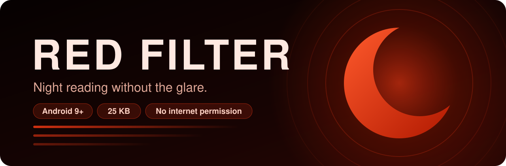
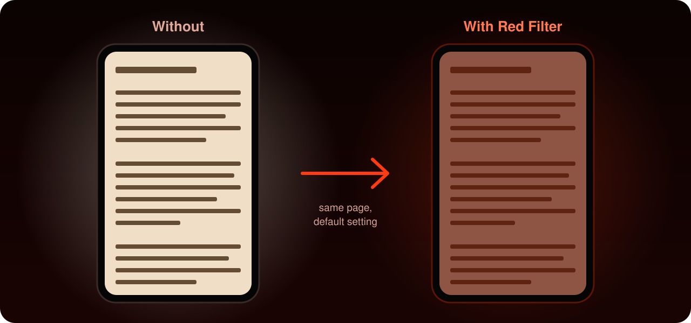

<p align="center"></p>

<p align="center">
  <a href="https://github.com/Nostramadeus/red-filter/releases/latest"><b>Download the APK (latest release)</b></a>
</p>

**Red Filter** puts one dark red colour layer over the whole screen of an Android phone, so a bright page stops
lighting up the room at night. You set how dark and how red. That is all it does.

<p align="center"></p>

## What you get

| | |
|---|---|
| **One layer over everything** | An accessibility overlay: it sits above the app you are in and lets every touch through. |
| **Three sliders** | Darkness, colour strength, colour (pure red to orange). Every change shows at once. |
| **Controls where you are** | A notification with `Turn off` and `Adjust`, a small slider window, and a quick-settings tile. |
| **Nothing else** | No internet permission, no ads, no tracking, no account. The app is about 25 KB. |
| **Cannot black itself out** | The screen always keeps at least 4% of its light, so the controls stay visible. |

<p align="center"></p>

## Install

1. On the phone, open the [latest release](https://github.com/Nostramadeus/red-filter/releases/latest) and download
   `RedFilter-<version>.apk`. Open the file. If the browser asks, allow it to install apps.
2. Switch the filter on: **Settings > Accessibility > Downloaded apps > Red Filter**.
   Android 13 and later block this for an app that did not come from a store. If the switch is greyed out or you see
   "Restricted setting": **Settings > Apps > Red Filter > the three-dot menu > Allow restricted settings**, then go back
   and switch it on.
3. Open Red Filter once and allow notifications. That gives you the notification with `Turn off` and `Adjust`.

Needs Android 9 or later.

## Why the filter stays the same in every app

Red Filter was written because the filter app used before it did not hold. What was measured, on one phone with
Android 16 and Twilight 14.32 (settings 1500K, intensity 69, screen dim 42):

| | Page background of an e-book (true colour `240, 222, 199`) |
|---|---|
| Twilight, first 3 seconds in the reading screen | `144, 95, 79` (red and dark, as set) |
| Twilight, from about second 3 on | `219, 163, 139` (still tinted, darkening gone) |
| Red Filter, 6 screenshots over 10 seconds | `143, 85, 68` every time |

In that one e-reader (ReadEra), about 3 seconds after the reading screen opened, Twilight drew its overlay again
without its "Screen dim" part. The red tint stayed and the darkening went, so the page turned light. Changing
Twilight's sliders did not bring it back while the book was open. It was the same with Twilight's accessibility
service on and off, and other apps on that phone were not affected. Why Twilight does this is not known: it is
closed source, no setting was found for it, and it logged nothing.

Why Red Filter cannot do the same thing:

- **It does not look at what is on the screen or which app is open.** There is no code that reacts to an app. The
  layer is painted once and painted again only when you move a slider, use the switch, or the screen turns on, always
  with the same saved colour.
- **Darkness and colour are one colour, not two parts.** They are folded into a single value before drawing (formula
  below), so one cannot drop out while the other stays.
- **Only the strong kind of overlay.** An ordinary app overlay must stay below 80% opacity or Android stops touches
  from passing through it, so a filter that falls back to one gets weaker. Red Filter draws only as an accessibility
  overlay, which has no such limit. If its service is not running there is no filter at all, and the app says so,
  instead of a weaker one.

This is one measurement on one phone and one version of each app. Twilight does much more than Red Filter:
sunrise and sunset schedules, profiles, colour temperature in Kelvin, smart-light control. Red Filter has none of that.

## How the colour is made

Two layers are folded into one colour: a black layer (Darkness) and a colour layer on top of it (Colour strength).
For a screen pixel `P`:

```
shown = P x (1 - strength) x (1 - darkness) + colour x strength
```

With the default look (darkness 55%, strength 24%, colour `255, 39, 0`), white `255, 255, 255` is shown as about
`148, 97, 88` and black as about `60, 9, 0`.

## Updates

- New versions appear on the [Releases page](https://github.com/Nostramadeus/red-filter/releases). Install the new
  APK over the old one; your settings stay (every release is signed with the same key).
- The app does **not** update itself, on purpose. To do that it would need the internet permission and the right to
  install apps, inside an app that holds accessibility access. Red Filter keeps to no network access at all.
- If you want automatic checks: [Obtainium](https://github.com/ImranR98/Obtainium) is an open-source app that
  watches GitHub releases. Add `https://github.com/Nostramadeus/red-filter` to it and it tells you when a new
  version is out and installs it with one confirmation.

## Why it asks for accessibility access

Android only lets an accessibility service draw a layer that covers every app and still passes touches through
at any darkness. Red Filter uses the service for that one layer. It asks for no screen content
(`canRetrieveWindowContent="false"`), handles no events, and has no internet permission, so nothing can leave the phone.

## If the phone switches the filter off

Some phones (OPPO, OnePlus, Xiaomi, Huawei and others) close background apps in batches. Android then leaves the
service marked "on" but not running, and does not start it again by itself. On the phone this app was written for,
that happened about once a day. The filter stays off until the service is switched off and on again.

**One tap, no setup.** When this happens the notification changes to "Red Filter stopped". Tap it: the accessibility
page opens. Switch Red Filter off, then on. The app shows the same button ("Open accessibility settings") while the
filter is not running. For an icon on the home screen: long-press the Red Filter icon and drag "Accessibility" out
of the menu.

**Permanent, set up once.** With the permission below, Red Filter does the off-and-on by itself: when the app, the
tile or the notification is used, and on a check every 15 minutes.

```bash
adb shell pm grant io.github.nostramadeus.redfilter android.permission.WRITE_SECURE_SETTINGS
```

- Needs a computer with `adb` and USB debugging switched on. Some phones refuse the line until a developer option
  such as "Disable permission monitoring" is switched on.
- No computer: on Android 11 and later, an app that runs `adb shell` commands on the phone itself through
  "Wireless debugging" (for example LADB, or Shizuku with a terminal app) can run the same line.
- Android has no way for an app to get this permission without `adb`, and no other way for an app to restart its
  own accessibility service.

**Fewer stops.** In the phone's settings for Red Filter, allow background activity and auto-launch, and set battery
use to unrestricted. On phones with a lock in the recent-apps screen, lock Red Filter there. The names differ per
brand; [dontkillmyapp.com](https://dontkillmyapp.com) lists them.

## Build it yourself

No Gradle, a few seconds:

```bash
bash build.sh            # writes RedFilter.apk
bash build.sh install    # also sends it to a phone over USB and switches the filter on
```

Needs a JDK (17 works) and the Android SDK with `build-tools` and one `platforms/android-NN` folder.
Set `ANDROID_SDK_ROOT`, `BUILD_TOOLS`, `PLATFORM`, `JAVA_HOME`, `KEYSTORE` or `KS_PASS` in the environment, or in a
file `local.env` next to `build.sh`, if the defaults at the top of the script do not match your machine. Without a
keystore of your own the build is signed with the Android debug key, and such a build cannot be installed over a
release from this page (different key): uninstall first.

## Status

Early. Written for one phone (Android 16) and used there. Not tested on other devices or Android versions yet.
The filter also shows in screenshots and screen recordings, because it is a real layer on the screen.

## Files

| Path | What |
|---|---|
| `src/.../FilterService.java` | the overlay |
| `src/.../Prefs.java` | saved values and the colour formula |
| `src/.../Main.java`, `Popup.java` | the full screen and the small window (same controls) |
| `src/.../Note.java`, `Tile.java` | notification and quick-settings tile |
| `src/.../Heal.java` | reconnects the service; handles the notification's on/off button |
| `build.sh` | the whole build |

## Licence

MIT, see [LICENSE](LICENSE).
